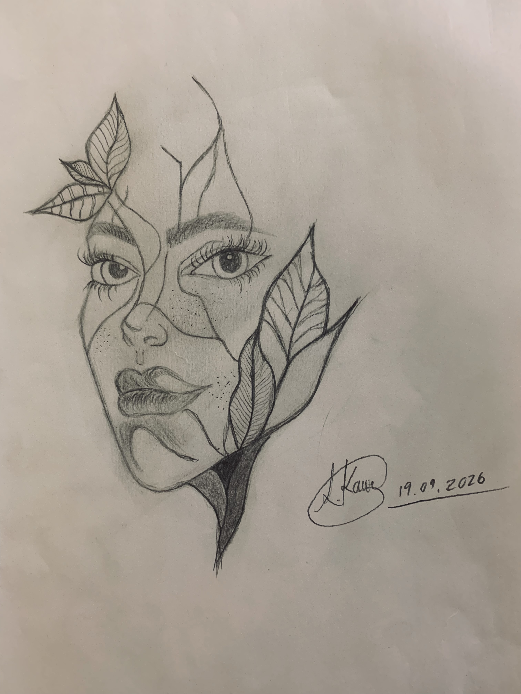

# 🎨 Personalities and Growth

<table>
  <thead>
    <tr>
      <th>Dublin Core Element</th>
      <th>Value</th>
    </tr>
  </thead>
  <tbody>
    <tr>
      <td bgcolor="#FFE6F0"><b>Title</b></td>
      <td>Personalities and Growth</td>
    </tr>
    <tr>
      <td bgcolor="#FFE6F0"><b>Subject</b></td>
      <td>Visual art; Pencil sketch; Identity; Personal growth; Resilience; African names; Marutla</td>
    </tr>
    <tr>
      <td bgcolor="#FFE6F0"><b>Description</b></td>
      <td>This item is a pencil sketch drawing depicting a woman surrounded by multiple personalities attempting to empower or overpower her, yet she continues to grow and rise above them regardless. Given by a special friend, the artwork holds deep personal meaning as a visual reflection of the owner's African name, Marutla, symbolizing strength, inner transformation, and continuous growth.</td>
    </tr>
    <tr>
      <td bgcolor="#FFE6F0"><b>Creator</b></td>
      <td>Lehakwe</td>
    </tr>
    <tr>
      <td bgcolor="#FFE6F0"><b>Source</b></td>
      <td>Personal collection of Marutla Motsholane</td>
    </tr>
    <tr>
      <td bgcolor="#FFE6F0"><b>Publisher</b></td>
      <td>NA</td>
    </tr>
    <tr>
      <td bgcolor="#FFE6F0"><b>Date</b></td>
      <td>2026</td>
    </tr>
    <tr>
      <td bgcolor="#FFE6F0"><b>Contributor</b></td>
      <td>Marutla Motsholane</td>
    </tr>
    <tr>
      <td bgcolor="#FFE6F0"><b>Rights</b></td>
      <td>© Lehakwe, 2026. Preserved for personal display and digital archiving within the INL340 Time Capsule project.</td>
    </tr>
    <tr>
      <td bgcolor="#FFE6F0"><b>Relation</b></td>
      <td>NA</td>
    </tr>
    <tr>
      <td bgcolor="#FFE6F0"><b>Format</b></td>
      <td><a href="lehakwe.jpg">View High-Res Sketch (lehakwe.jpg)</a></td>
    </tr>
    <tr>
      <td bgcolor="#FFE6F0"><b>Language</b></td>
      <td>No linguistic content</td>
    </tr>
    <tr>
      <td bgcolor="#FFE6F0"><b>Type</b></td>
      <td>Still Image</td>
    </tr>
    <tr>
      <td bgcolor="#FFE6F0"><b>Identifier</b></td>
      <td>NA</td>
    </tr>
    <tr>
      <td bgcolor="#FFE6F0"><b>Coverage</b></td>
      <td>South Africa, 2026</td>
    </tr>
  </tbody>
</table>

 

### Item Type Metadata

<table>
  <thead>
    <tr>
      <th>Metadata Element</th>
      <th>Value</th>
    </tr>
  </thead>
  <tbody>
    <tr>
      <td bgcolor="#FFE6F0"><b>Original Format</b></td>
      <td>Pencil sketch on paper</td>
    </tr>
    <tr>
      <td bgcolor="#FFE6F0"><b>Physical Dimensions</b></td>
      <td>A4 / 210 x 297 mm Single-page drawing</td>
    </tr>
  </tbody>
</table>
